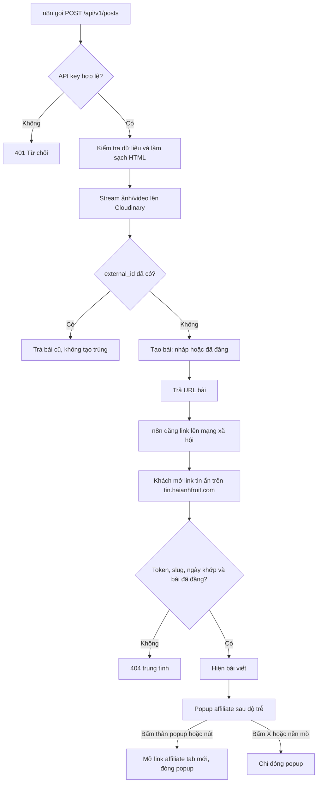

# BA Addendum v9 — Nâng cấp giao diện, API đăng bài cho n8n, Tin tức ẩn kèm popup affiliate
- Ngày: 2026-11-12
- Tham chiếu: `00_ba.md` và các addendum v2–v7 (đánh số v9 để khớp với `10_plan_v9.md`, vì `10_plan_v8.md` đã dùng cho "Sản phẩm nhiều danh mục")
- Lý do bổ sung: chủ web yêu cầu 3 hạng mục mới sau khi giai đoạn 1–8 và các phase mở rộng đã xong.

---

## 1. TÓM TẮT 1 TRANG
- **Mục tiêu**: (1) làm mới giao diện công khai theo phong cách "fresh-tech"; (2) cho n8n đăng bài tự động qua API; (3) thêm khu tin tức ẩn trên subdomain, mỗi bài kèm popup affiliate Shopee/TikTok.
- **In-scope**: schema bài viết mở rộng, API key, API đăng bài, upload ảnh/video qua Cloudinary (stream), admin quản lý tin ẩn, định tuyến theo host, popup + thống kê, nâng cấp trang bài viết, tối ưu vận hành VPS 1GB, 3 bản mẫu giao diện rồi áp dụng bản được chọn.
- **Phương án khuyến nghị**: một codebase, một bảng bài viết (`BlogPost`) dùng chung cho blog và tin ẩn (phân biệt bằng `post_type`), định tuyến theo `Host`, n8n gọi API qua `localhost`.
- **Rủi ro lớn nhất**: RAM 1GB chạy chung web + PostgreSQL + n8n; rủi ro chính sách affiliate nếu popup gây hiểu nhầm. Giảm rủi ro: bắt buộc swap, không xử lý media trên server, popup minh bạch (X chỉ đóng).
- **Nghiệm thu quan trọng nhất**: n8n gọi API tạo được bài nháp có ảnh; tin ẩn chỉ truy cập được bằng đúng URL trên subdomain, không lộ ở bất kỳ nơi nào; popup đúng quy tắc bấm.

## 2. BỐI CẢNH & MỤC TIÊU
- Người dùng: chủ shop Hải Anh Fruit (admin), khách vào từ link tin tức/mạng xã hội, n8n (máy gọi API).
- Mục tiêu đo được: số bài đăng tự động mỗi tuần; lượt bấm affiliate trên mỗi bài; thời gian tải trang chủ trên điện thoại.
- Ràng buộc hạ tầng: VPS 1 vCPU / 1GB RAM / 20GB SSD, chạy chung PostgreSQL + Node (PM2) + n8n (`n8n.haianhfruit.com`) + Nginx. Domain `haianhfruit.com` (theo `docs/10-self-host-n8n.md`).

## 3. HIỆN TRẠNG TỪ CODEBASE
- `prisma/schema.prisma`: `BlogPost` (title, slug unique, summary, content, thumbnail_url, author_id, is_published, published_at). Không có loại bài, token, affiliate, video, thống kê.
- Admin bài viết: `src/modules/blogs/` (route `/admin/blogs`); public: `src/modules/public/blogs/` (`/blog`, `/blogs`). Trang chủ lấy bài mới ở `src/modules/public/home/home.controller.js` (dòng ~60). Thư mục `src/modules/blog/` là bản cũ trùng tên, chưa mount trong route.
- `src/middlewares/upload.middleware.js`: multer memoryStorage, giới hạn 5MB, chuyển buffer sang base64 data URI rồi upload ảnh (tốn RAM ~1.33 lần, chỉ hỗ trợ ảnh).
- `src/routes/api.route.js`: chỉ có vài endpoint công khai, chưa có xác thực API key.
- `src/app.js`: mỗi request đều truy vấn DB lấy danh mục và dùng session lưu DB — không phù hợp cho trang tin tức tải cao.
- Nội dung bài viết lưu HTML thô, chưa có bước làm sạch (XSS) cho nội dung đến từ API.
- `ecosystem.config.js`: `max_memory_restart: "1G"` quá lớn cho VPS 1GB chạy chung; scripts `pm2:*` dùng `all` ảnh hưởng cả n8n.

## 4. USER JOURNEY (TO-BE)
- n8n → gọi API đăng bài (nháp hoặc đăng ngay) → nhận về link → n8n đem link đi đăng mạng xã hội.
- Khách bấm link tin ẩn → thấy bài + popup lớn → bấm popup thì mở link affiliate ở tab mới, đọc tiếp bài ở tab cũ.

## 5. FLOW (Mermaid)


## 6. PHẠM VI
**In-scope**
- Hạng mục 1: design system + làm lại giao diện công khai (trang chủ, shop, chi tiết sản phẩm, giỏ hàng, checkout, blog) theo bản mẫu được chọn; admin giữ nguyên, chỉ thêm màn hình mới cần cho tính năng mới.
- Hạng mục 2: API key, API đăng bài, upload ảnh/video, cải tiến trang bài viết (OG, mục lục, thời gian đọc, bài liên quan, sản phẩm liên quan).
- Hạng mục 3: tin ẩn trên subdomain, token, popup affiliate, thống kê, quản lý admin.
- Vận hành: swap, PM2, Nginx subdomain, logrotate, cache menu.

**Out-of-scope**
- Đổi stack (SPA/React), đổi giao diện admin cũ, thanh toán online, tự động đăng lên mạng xã hội từ web (do n8n lo), editor video, lưu video trên VPS, cloak/redirect cưỡng ép, mở tab tự động không do người dùng bấm.

## 7. YÊU CẦU CHỨC NĂNG (MoSCoW)
**Must**
- FR-01 Mở rộng `BlogPost` với `post_type` (`blog` | `news`), `access_token`, `url_date`, `affiliate_url`, thông tin popup, video nhúng, gallery, `external_id`, `source`, SEO, tags.
- FR-02 `ApiKey`: tạo/thu hồi ở admin, chỉ hiện key một lần, lưu hash.
- FR-03 `POST /api/v1/posts` nhận JSON hoặc multipart; `status` = `draft` (mặc định) hoặc `published`; `type` = `blog` hoặc `news`.
- FR-04 Idempotency theo `external_id` + `source`: gọi lại không tạo bài trùng.
- FR-05 Upload ảnh: nhận file hoặc URL, đẩy lên Cloudinary, không ghi đĩa; tự tối ưu (`f_auto`, `q_auto`).
- FR-06 Video: mặc định link nhúng (YouTube/TikTok/Facebook, whitelist host); upload file tối đa 20MB mp4, stream thẳng lên Cloudinary.
- FR-07 Làm sạch HTML nội dung từ API (allowlist thẻ/thuộc tính; iframe chỉ từ host whitelist).
- FR-08 Khu tin ẩn trên subdomain `tin.haianhfruit.com`, URL `/tin-tuc/{dd-mm-yyyy}/{slug}/{token}`; sai bất kỳ phần nào → 404.
- FR-09 Tin ẩn không xuất hiện ở menu, blog, trang chủ, sitemap, tìm kiếm, robots; có `noindex, nofollow, noarchive`.
- FR-10 Popup affiliate: lớn; thân popup/nút CTA → mở link tab mới + đóng; X và nền mờ → chỉ đóng; hiện lại mỗi lần tải/vào trang; nhãn "Quảng cáo · Liên kết tiếp thị".
- FR-11 Link affiliate theo từng bài, nếu trống dùng link mặc định trong Settings; chỉ chấp nhận https và host nằm trong danh sách cho phép (Settings).
- FR-12 Thống kê theo bài và theo ngày: lượt vào, hiện popup, bấm CTA (popup/banner/cuối bài), đóng popup; admin xem được.
- FR-13 Admin quản lý tin ẩn: danh sách, tạo/sửa, nút "Sao chép link đầy đủ", xem trước bản nháp, xem thống kê.
- FR-14 Định tuyến theo host: host tin ẩn chỉ phục vụ khu tin; host chính trả 404 cho `/tin-tuc/*`; session và truy vấn danh mục chỉ chạy ở host chính.
- FR-15 Ràng buộc vận hành: swap, giới hạn RAM PM2, script PM2 chỉ nhắm web, cache danh mục.
- FR-16 3 bản mẫu giao diện (A Fresh Bento, B Dark Premium, C Editorial Fresh); chủ web chọn; áp dụng bản chọn cho giao diện công khai.

**Should**
- FR-17 Banner dính dưới màn hình và khối CTA cuối bài/giữa bài (thêm điểm bấm hợp lệ).
- FR-18 Trang bài viết chuyên nghiệp: Open Graph, mục lục tự sinh, thời gian đọc, bài/sản phẩm liên quan, nút chia sẻ.
- FR-19 Rate limit cho API và cho các lần 404 trên host tin ẩn.
- FR-20 Đếm dung lượng upload Cloudinary tháng này và cảnh báo ngưỡng trong admin.
- FR-21 `PUT`/`DELETE` `/api/v1/posts/:id` để sửa hoặc gỡ bài.

**Could**
- FR-22 Nhận nội dung markdown (`content_format`), tách A/B nhiều popup creative, lên lịch đăng.

**Won't**
- Tự mở link khi tải trang; X hoặc nền mờ mở link; cloaking; lưu media trên VPS.

## 8. YÊU CẦU PHI CHỨC NĂNG
- Hiệu năng: tin ẩn không dùng session, không truy vấn danh mục; LCP trang bài dưới 2.5s trên 4G; thống kê gom ghi theo lô.
- Bảo mật: API key hash SHA-256, so sánh an toàn; làm sạch HTML; token 16 byte ngẫu nhiên (base64url 22 ký tự); rate limit chống dò; chỉ cho link affiliate host đã cho phép; API chỉ nhận HTTPS trên host công khai, `localhost` cho n8n.
- Vận hành: log xoay vòng, RAM ngân sách (Node ≤ 250MB, n8n ≤ 450MB, PostgreSQL ≤ 150MB), swap 2GB.
- Tương thích ngược: các cột mới đều nullable hoặc có default; bài cũ mặc định `post_type='blog'`; `is_published` giữ nguyên là nguồn trạng thái (draft = `false`).

## 9. QUYỀN & TRẠNG THÁI
- Admin: quản lý tin ẩn, API key, link affiliate mặc định, xem thống kê.
- API client (n8n): quyền `posts:write` qua API key; không có quyền admin khác.
- Khách: chỉ đọc bài `is_published=true` qua URL đúng; popup/tracking không cần đăng nhập.
- Trạng thái bài: `draft` (`is_published=false`) không truy cập công khai (admin xem trước qua đường admin); `published` truy cập được; gỡ bài = trở lại nháp.

## 10. MÔ HÌNH DỮ LIỆU (Prisma, sơ bộ)
```
BlogPost (thêm cột, tất cả nullable hoặc có default)
  post_type        String   @default("blog")      -- blog | news
  access_token     String?  @unique               -- chỉ dùng cho news
  url_date         String?                        -- dd-mm-yyyy, cố định khi tạo
  affiliate_url    String?
  ad_headline      String?
  ad_image_url     String?
  ad_cta_text      String?
  video_url        String?                        -- link nhúng hoặc URL video Cloudinary
  gallery          Json?                          -- mảng URL ảnh
  tags             String?
  seo_title        String?
  seo_description  String?
  source           String?                        -- vd: n8n
  external_id      String?
  @@unique([source, external_id])
  @@index([post_type, is_published, published_at])

ApiKey
  id, name, key_prefix, key_hash @unique, scopes (mặc định "posts:write"),
  is_active, last_used_at, created_at, revoked_at

NewsStatDaily
  id, post_id (FK BlogPost, cascade), day (date), event String, count Int
  @@unique([post_id, day, event])
  -- event: view | popup_show | popup_close | cta_popup | cta_banner | cta_inline

Setting (dùng bảng sẵn có, thêm key)
  news.default_affiliate_url, news.affiliate_hosts, news.popup_delay_ms, news.host
```
- Migration: file mới `prisma/migrations/<timestamp>_news_api_foundation`; rollback = xóa 2 bảng mới và các cột mới (dữ liệu cũ không bị chạm).
- `url_date` cố định khi tạo để đổi `published_at` không làm hỏng link đã phát hành.

## 11. API CONTRACT
- Xác thực: `Authorization: Bearer hq_<key>` hoặc `X-API-Key`. Trả 401 nếu sai/thu hồi; 429 nếu vượt rate limit.
- `POST /api/v1/posts` (JSON hoặc `multipart/form-data`)
  - Trường: `title` (bắt buộc), `content` (HTML), `summary`, `slug`, `type` (`blog`|`news`, mặc định `blog`), `status` (`draft`|`published`, mặc định `draft`), `published_at`, `cover` (file hoặc `cover_url`), `images[]`/`image_urls[]`, `video_embed_url` hoặc `video` (file mp4 ≤ 20MB), `tags`, `affiliate_url`, `ad_headline`, `ad_image_url`, `ad_cta_text`, `seo_title`, `seo_description`, `source`, `external_id`.
  - Thành công: `201` (bài mới) hoặc `200` (đã tồn tại theo `external_id`): `{ id, type, status, slug, url, admin_url }`; với `news`, `url` là link đầy đủ có token.
  - Lỗi: `400` (thiếu tiêu đề, dữ liệu sai, affiliate host không cho phép), `401`, `413` (quá dung lượng), `415` (định dạng không hỗ trợ), `429`.
- `PUT /api/v1/posts/:id`, `DELETE /api/v1/posts/:id` (Should).
- `POST /t` (beacon thống kê, host tin ẩn): `{ id, token, event }`, trả `204`; sai token hoặc event không hợp lệ thì bỏ qua.

## 12. UI/UX BEHAVIOR
- Popup: phủ khoảng 90% chiều cao trên điện thoại, 640–720px trên máy tính; ảnh sản phẩm lớn, tiêu đề, giá/khuyến mãi, nút CTA có nhịp; thân và nút mở link; X 32px bấm được, góc trên phải, màu nhạt; nền mờ chỉ đóng; phím Esc đóng; focus trap, `aria-modal`; hiện sau `news.popup_delay_ms` (mặc định 1500ms); tôn trọng `prefers-reduced-motion`.
- Bài tin ẩn: layout riêng (không menu/giỏ hàng/đăng nhập), dòng công khai "Bài có liên kết tiếp thị".
- Admin tin ẩn: bảng danh sách (tiêu đề, trạng thái, ngày, lượt vào, lượt bấm), nút copy link, trạng thái trống, thông báo lỗi.
- Giao diện công khai mới: theo bản mẫu được chọn (chi tiết trong plan).

## 13. EDGE CASES
- n8n gọi lại cùng `external_id` → trả bài cũ (200).
- Trùng slug → tự thêm hậu tố `-2`, `-3`.
- Upload lỗi giữa chừng → không tạo bài, trả lỗi rõ; không để lại bản ghi dở.
- Link affiliate sai host/không phải https → từ chối (400).
- Token đúng nhưng bài chuyển về nháp → 404.
- Nhiều upload cùng lúc → giới hạn đồng thời 2 để tránh hết RAM.
- Bot thu thập → bỏ qua User-Agent bot khi đếm thống kê.
- Mất điện/restart khi buffer thống kê chưa ghi → chấp nhận mất tối đa vài chục giây số liệu; flush khi nhận tín hiệu tắt.

## 14. TIÊU CHÍ NGHIỆM THU
- AC-1 Given API key hợp lệ, When gửi POST với tiêu đề + ảnh bìa + nội dung, Then bài `draft` được tạo, ảnh nằm trên Cloudinary, trả `url`.
- AC-2 Given cùng `external_id`, When gửi lần hai, Then không tạo bài mới, trả 200.
- AC-3 Given bài `news` đã đăng, When mở đúng URL trên `tin.`, Then thấy bài; sai token/slug/ngày → 404; mở trên host chính → 404.
- AC-4 Tin ẩn không có trong `/sitemap.xml`, `/blog`, trang chủ, menu; robots host `tin.` chặn toàn bộ.
- AC-5 Popup hiện sau độ trễ mỗi lần tải; bấm thân → mở tab mới tới link affiliate; bấm X/nền → chỉ đóng.
- AC-6 Admin thấy thống kê lượt vào/hiện popup/bấm của từng bài.
- AC-7 Link affiliate rỗng dùng link mặc định; link ngoài danh sách host bị từ chối.
- AC-8 Chạy đồng thời web + n8n + PostgreSQL trên 1GB RAM với swap, không bị OOM trong bài test tải nhẹ.
- AC-9 Giao diện mới đạt: điểm Lighthouse Performance mobile ≥ 80 cho trang chủ (mục tiêu).

## 15. PHƯƠNG ÁN TRIỂN KHAI (đã chốt)
- Giữ duy nhất phương án: một bảng bài viết dùng chung (`post_type`), định tuyến theo host trong cùng ứng dụng, n8n gọi qua `localhost:3000`, media đẩy thẳng Cloudinary. Lý do: ít RAM nhất, ít code nhất, dễ tách sang tên miền riêng về sau bằng đổi cấu hình `news.host`.

## 16. RỦI RO / PHỤ THUỘC
- RAM 1GB (n8n chạy chung): bắt buộc swap, cấu hình PM2, giảm concurrency n8n.
- Cloudinary free tier: băng thông/dung lượng hữu hạn → video ưu tiên link nhúng, giới hạn 20MB.
- Chính sách Shopee/TikTok Affiliate và Google: popup minh bạch, không click lừa.
- Subdomain vẫn có thể ảnh hưởng uy tín tên miền chính; có thể chuyển sang tên miền riêng sau.
- `docs/10-self-host-n8n.md` có chứa `N8N_ENCRYPTION_KEY` trông như khóa thật → cần chủ web kiểm tra/rotate.

## 17. DECISION LOG
- 2026-11-12: Dùng chung bảng `BlogPost` với `post_type`; giữ `is_published` làm nguồn trạng thái.
- 2026-11-12: Popup: thân popup/CTA mở link; X và nền mờ chỉ đóng (không làm X khó bấm, không mở link khi bấm ngoài).
- 2026-11-12: Link affiliate theo bài, dự phòng một link mặc định; allowlist host.
- 2026-11-12: Subdomain `tin.haianhfruit.com`, định tuyến theo host, token 16 byte base64url.
- 2026-11-12: Slug không dấu (`tin-du-an-dat-vung-ven`), tự sinh từ tiêu đề.
- 2026-11-12: Có thống kê theo bài và theo ngày.
- 2026-11-12: Video mặc định link nhúng; upload ≤ 20MB qua Cloudinary; không lưu đĩa VPS.
- 2026-11-12: n8n chạy chung VPS, gọi API qua localhost; cần swap 2GB.
- 2026-11-12: Giao diện: làm 3 bản mẫu trước khi áp dụng; admin giữ nguyên.
- 2026-11-12: CHỐT bản C (Editorial) nhưng chuyển sang NỀN TRẮNG, giữ nhận diện hiện tại (xanh đậm #1b4d3e, vàng #f4b400, chữ Playfair Display + Outfit) và giữ nguyên bộ khung trang chủ cũ (slider banner admin, thanh tin cậy, danh mục, flash sale đếm ngược, nổi bật, combo, lý do chọn, đánh giá, blog). Mẫu tham chiếu: `docs/mockups/mau-c2-nen-trang.html`.
- 2026-11-12: Yêu cầu chất lượng chuyển động: mượt, có mục đích, không làm giao diện tệ hơn bản cũ. Không đổi logic nghiệp vụ; chỉ thay lớp trình bày và tương tác.

## 18. ASSUMPTIONS + QUESTIONS
Assumptions
1. Tên miền chính là `haianhfruit.com` (theo tài liệu n8n); subdomain tin tức mặc định `tin.haianhfruit.com`.
2. "20GB" là dung lượng SSD của VPS.
3. Cloudinary hiện dùng được cho cả ảnh và video (tài khoản đã cấu hình trong `.env`).
4. Cho phép host affiliate mặc định: `shopee.vn`, `s.shopee.vn`, `shope.ee`, `tiktok.com`, `vt.tiktok.com`, `vm.tiktok.com`, `shop.tiktok.com`.
5. Mức nội dung markdown/lên lịch đăng để sau (Could).

Questions (không chặn bước plan)
1. Chủ web chọn bản mẫu giao diện nào sau khi xem A/B/C?
2. Khóa `N8N_ENCRYPTION_KEY` trong docs có phải khóa đang dùng thật không?

## 19. DEFINITION OF READY
- Đã chốt phương án; đã có danh sách trường dữ liệu, API và quy tắc popup/host.
- Quy tắc quyền/trạng thái rõ.
- Verification: `npx prisma validate`, `node --check`, biên dịch EJS, gọi API bằng `curl` trên môi trường dev, kiểm tra route bằng `tin.localhost:3000`.
- Phần chờ: lựa chọn bản mẫu giao diện (ảnh hưởng nhóm slice giao diện).

## 20. DEEP THINKING RESULTS
**Phản biện**
1. *Dữ liệu 10 lần?* Bảng thống kê gom theo ngày nên không phình theo lượt xem; bài viết chủ yếu là text và URL ảnh; ổ đĩa không chứa media.
2. *Dùng sai/lạm dụng?* Lộ API key → có thu hồi; dò token → rate limit + token 128 bit; link affiliate lạ → allowlist; HTML độc → làm sạch.
3. *Bỏ 1 yêu cầu Must?* Có thể bỏ thống kê và vẫn chạy, nhưng chủ web đã chọn có; thiết yếu nhất là FR-01, 03, 08, 10, 14.

**Second-order**
- Trang chủ (`home.controller.js`) và blog công khai hiện không lọc loại bài → phải thêm `post_type='blog'` để tin ẩn không lọt ra.
- Admin `/admin/blogs` cũng cần lọc để tách blog và tin ẩn.
- Không có phụ thuộc cron; thống kê flush bằng timer trong tiến trình.
- Race condition: tạo bài trùng `external_id` đồng thời → dựa vào unique constraint, bắt lỗi P2002 và trả bài cũ.

**Consistency**
- Giữ cấu trúc module `src/modules/<feature>/`, route-controller-service, flash message ở admin, tiếng Việt có dấu.

**Đề xuất bổ sung (không bắt buộc)**
- Thêm trang "Thử API" trong admin (hiển thị ví dụ `curl` và payload mẫu cho n8n).
- Cache menu danh mục trong bộ nhớ 5 phút để giảm tải DB.
- Chuyển `uploadToCloudinary` sang `upload_stream` để bỏ bước base64 tốn RAM.

**Rủi ro triển khai**
- Kill switch: setting `news.enabled` tắt toàn bộ khu tin ẩn/API ngay không cần deploy.
- Rollback: giữ migration thuận nghịch như mục 10; giao diện mới ở nhánh riêng, có thể bật/tắt bằng layout cũ.
